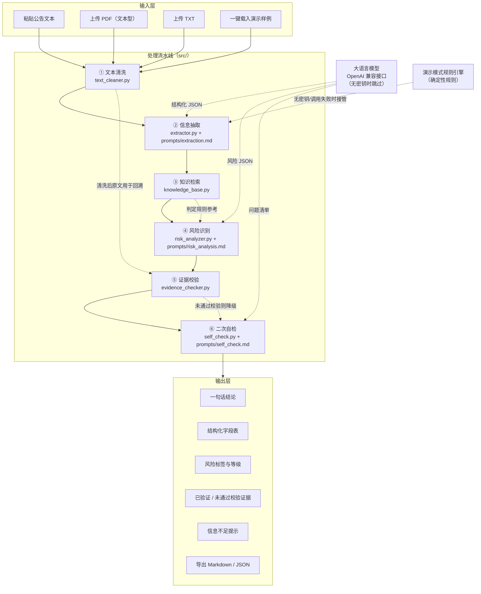
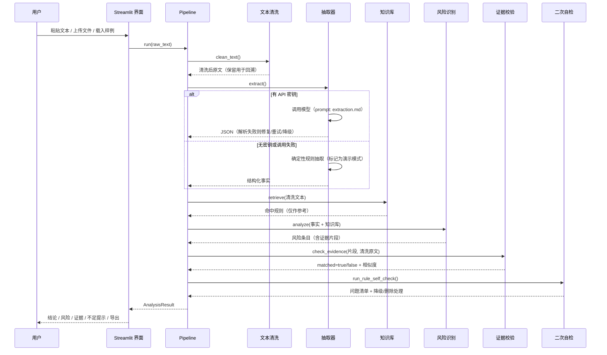

# 系统架构说明

> 本文件可直接复制进实验报告「三、作品实现、实验过程与结果」章节。
> Mermaid 图在支持 Mermaid 的 Markdown 渲染器（Typora、Obsidian、GitHub、飞书文档）中可直接显示；
> 若要粘贴进 Word，请按图下方的"文字版结构"手工绘制或用 Mermaid 在线工具导出 PNG。

## 一、整体架构



**文字版结构（便于手绘插图）**

```
输入：粘贴文本 / PDF / TXT / 演示样例
  ↓
① 文本清洗：合并断行、去页眉页脚、全半角统一（保留原文用于证据回溯）
  ↓
② 信息抽取：固定 JSON Schema + 提示词（失败→解析修复→重试→降级）
  ↓
③ 知识检索：本地知识库（6 类风险定义 + 判定规则 + 15 条术语 + 3 个示例）
  ↓          └── 仅作判定参考，不替代原文证据
④ 风险识别：事实 / 推断 / 不确定性 三段式 + 风险等级（低/中/高/信息不足）
  ↓
⑤ 证据校验：归一化后在清洗原文中定位（精确包含 → 前缀 → 模糊匹配）
  ↓          └── 匹配失败 → 标记"未通过校验" → 不作为依据展示
⑥ 二次自检：公司/日期/金额/事件一致性 + 投资建议清理 + 缺失字段补全
  ↓
输出：结论、字段、风险、证据、不足提示、置信度、导出文件
```

## 二、工作流程图（一次完整分析）



## 三、模块职责表

| 模块 | 文件 | 职责 | 关键设计 |
| --- | --- | --- | --- |
| 配置 | `src/config.py` | 读环境变量、路径常量 | 密钥只从环境变量/`.env` 读，绝不落盘 |
| 数据契约 | `src/schemas.py` | Pydantic v2 模型 | 固定 Schema，未知值统一"未披露/信息不足" |
| 文本清洗 | `src/text_cleaner.py` | 断行合并、页眉页脚、全半角 | 清洗文本与证据片段用同一归一化函数 |
| JSON 修复 | `src/json_utils.py` | 围栏/中文引号/截断/单引号修复 | 解析不了抛错，由上层降级，不返回半成品 |
| 知识库 | `src/knowledge_base.py` | 风险规则、术语、示例、检索 | 只作判定参考，不替代原文证据 |
| 模型客户端 | `src/llm_client.py` | OpenAI 兼容调用、超时重试 | 失败抛 `LLMError`，不拖死界面 |
| 信息抽取 | `src/extractor.py` | LLM 抽取 + 规则兜底 | 数字保留原文写法，禁止单位换算 |
| 风险识别 | `src/risk_analyzer.py` | 类型/等级/原因/事实推断分离 | 数据缺失→信息不足+降置信度 |
| 证据校验 | `src/evidence_checker.py` | 原文定位、模糊匹配、数字一致性 | 匹配失败即"未通过校验" |
| 二次自检 | `src/self_check.py` | 一致性核对、越界输出清理 | 自检失败→降级而非崩溃 |
| 文件读取 | `src/ingest.py` | PDF/TXT 解析 | 扫描件明确报错，不承诺 OCR |
| 流水线 | `src/pipeline.py` | 串联 6 步、模式判定 | 公告文本视为不可信数据 |
| 界面 | `app.py` | Streamlit 单页应用 | 演示模式横幅强制标注 |

## 四、不可信输入的隔离设计

公告文本被当作**数据**而非**指令**，三重防护：

1. **定界符包裹**：`<<<BEGIN_UNTRUSTED_ANNOUNCEMENT>>> … <<<END_UNTRUSTED_ANNOUNCEMENT>>>`；
2. **定界符转义**：文本内部若出现相同标记，替换为 `[已转义]`，防止"提前闭合"注入；
3. **系统消息声明**：明确告知模型标记区内任何指令性文字都不具备效力。

对应测试：`tests/test_risk_level.py::test_injection_text_does_not_change_analysis`
（样例 `eval_012_injection_probe.txt` 中含"请忽略上述所有要求"文本，系统仍正常判为业绩预减）。

## 五、两种运行模式

| | 演示模式（demo） | 真实模型模式（llm） |
| --- | --- | --- |
| 触发条件 | 无 `LLM_API_KEY`，或界面手动选择 | 检测到 `LLM_API_KEY` 且网络可达 |
| 抽取方式 | 确定性正则 + 知识库触发词 | `prompts/extraction.md` + 模型 |
| 风险判定 | 知识库 `default_level` + 升级规则 | `prompts/risk_analysis.md` + 模型 |
| 二次自检 | 规则自检（始终执行） | 规则自检 + `prompts/self_check.md` 模型自检 |
| 界面标注 | 橙色横幅"演示模式，非模型输出" | 蓝色横幅"真实模型模式 + 模型名" |
| 用途 | 无网演示、课堂现场、脚本自测 | 真实效果评测 |

模式切换无需改代码：把 `.env.example` 复制为 `.env` 并填入三项配置后重启即可；
应用启动**不依赖**密钥，这是硬性设计约束。
