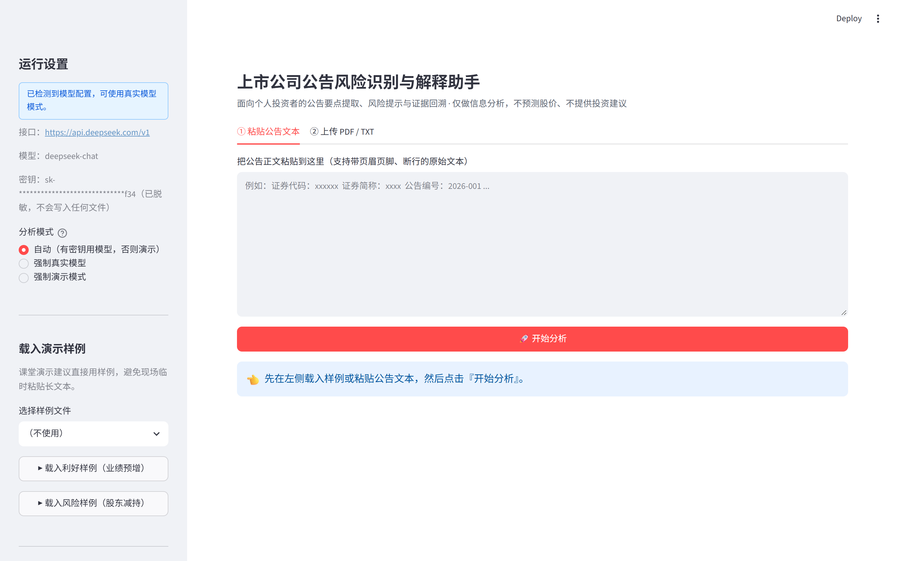
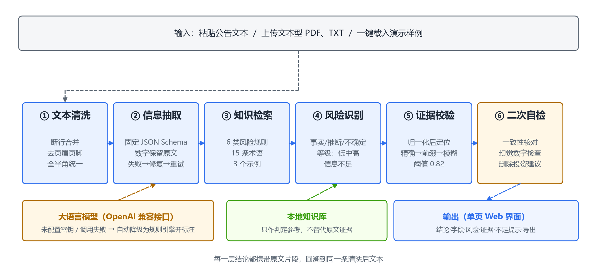
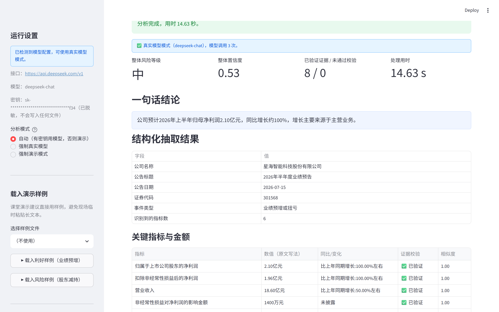
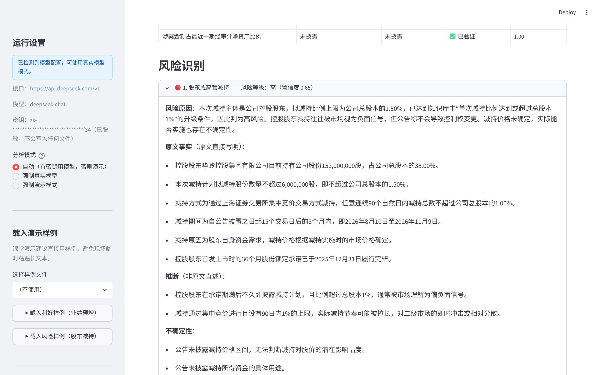
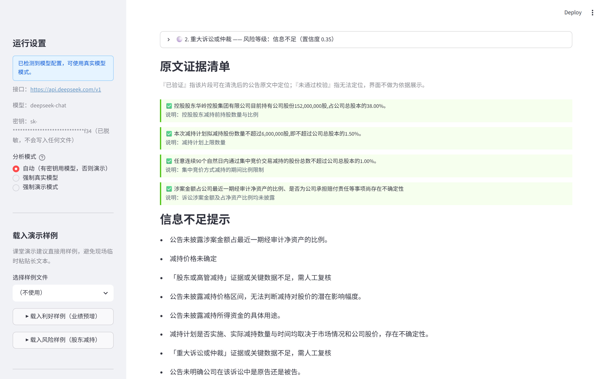
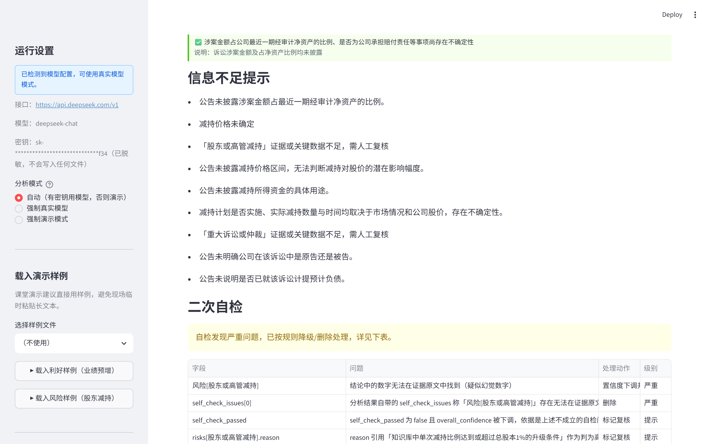
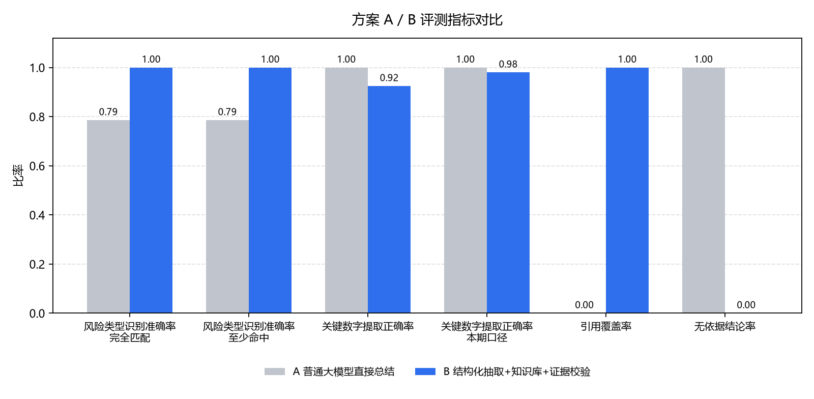

# 基于大语言模型的上市公司公告风险识别与解释助手

**副标题：面向个人投资者的公告要点提取、风险提示与证据回溯**

课程：财经智能体开发与应用　　学号【请填写】　　姓名【请填写】　　专业【请填写】

> 排版说明：本文件为可直接粘贴进 Word 的 Markdown 稿。按模板要求在 Word 中设置
> A4 纸、上下边距 2.5 厘米、左边距 3.0 厘米、右边距 2.5 厘米、各级标题宋体小四号加粗、
> 正文宋体五号、行距固定值 18 磅、页码页脚居中，并删除模板中的黄色提示文字。
> 电子文件名请改为「学号+姓名」。

---

## 一、案例选题

上市公司公告是投资者获取公司信息的第一手材料，但它并不"易读"。一份业绩预告、减持计划或诉讼公告动辄数千字，既有"扣除非经常性损益后的净利润""集中竞价""非经营性资金占用"这类专业术语，又夹杂大量表格、限定条件与免责表述。我在查阅公告时的真实感受是：读完一遍，仍然说不清这份公告是好消息还是坏消息、关键数字是多少、哪些话是公司说的、哪些话是我自己脑补的。

更值得警惕的是，把公告原文直接丢给通用大模型问一句"有什么风险"，得到的答案往往有两个问题：一是遗漏关键数字，把"2.10 亿元、同比增长 100%"写成"业绩大幅增长"；二是生成原文并不存在的内容，也就是"幻觉"，例如凭印象补上证券代码、把一次普通的子公司担保说成重大风险。对普通读者而言，这类错误比"看不懂"更危险，因为它看起来非常确定。

因此本作品的选题确定为：**面向个人投资者的公告要点提取、风险提示与证据回溯**。它要解决的不是"预测股价"，而是把一份长公告压缩成一张可读的结构化卡片，并让卡片上的每一条结论都能回到原文找到出处；凡公告没有写明的，系统必须明确输出"未披露"或"需人工复核"。这一约束贯穿选题始终，也是本作品与"智能投顾""选股助手"的根本区别。【请填写：补充你自己的选题动机或个人经历】

---

## 二、案例分析

### 2.1 问题拆解

把"读懂一份公告"拆成五个可验证的子任务，每个子任务都有明确的输入输出和可判定的对错：

1. **文本清洗**：PDF 抽取的文本存在断行、页眉页脚重复、全半角混用等问题，必须先归一化为可用于检索的正文；
2. **信息抽取**：从正文中抽出公司名称、公告标题、日期、事件类型、关键金额与同比变化；
3. **风险判定**：判断属于哪类风险、风险等级如何、原因是什么；
4. **证据回溯**：为每一条结论提供原文片段，并验证该片段确实存在于正文中；
5. **不确定性表达**：识别公告缺失的信息，明确提示而非编造。

这五步构成一个流水线，前一步的输出是后一步的输入，且每一步都可以单独写测试——这一点在第 3.3 节的缺陷复盘中起了决定作用。

### 2.2 分析框架

上市公司公告属于典型的**信息披露**文本，其经济意义在于缓解投资者与公司之间的信息不对称。参考信息披露与风险管理的通行思路，本作品采用"**事实—判断—不确定性**"三层分析框架：**事实层**是公告原文直接写明的客观信息（如"拟减持不超过公司总股本的 1.50%"）；**判断层**是基于事实与规则的推断（如"控股股东大额减持通常被市场理解为负面信号"）；**不确定性层**是公告未披露、导致结论不可靠的信息（如"未披露减持价格区间"）。

从数据科学角度看，这三层分别对应数据、模型推断与置信度评估，可与 CRISP-DM 中的数据理解、建模、评估三阶段对应。把三层显式分开，是为了避免"把推断包装成事实"——这是财经智能体最容易犯、也最难被读者察觉的错误。

### 2.3 风险类型的确定

结合信息披露实务中最常见、对投资者判断影响最直接的事项，本作品设定六类风险：业绩预增或扭亏、业绩预减或亏损、股东或高管减持、重大诉讼或仲裁、对外担保或资金占用、审计意见异常或其他监管风险，并为每一类配置定义、触发关键词与等级判定规则。等级分为"低、中、高、信息不足"四档，其中"信息不足"是刻意保留的档位——当关键数据缺失时，系统必须选择它，而不是在"低/中/高"里硬选一个。

### 2.4 工具、模型与知识组织

技术栈为 Python 3.13 + Streamlit（界面）+ pypdf（PDF 解析）+ Pydantic v2（数据契约）+ pandas/matplotlib（评测与图表）+ pytest（测试）。模型侧通过 OpenAI 兼容接口调用，由环境变量 `LLM_BASE_URL`、`LLM_API_KEY`、`LLM_MODEL` 配置，本次实验使用 deepseek-chat；密钥只从本机 `.env` 读取，不写入源码、日志或任何提交文件，仓库中只提供 `env.example`。

知识库是本地小型 JSON，包含六类风险的定义与判定说明、15 条金融术语解释、3 个带期望输出的正确示例，采用关键词加权检索，不依赖向量库，可完全离线运行。**知识库只提供判定参考，是否成立必须有原文证据**——这一边界在提示词与代码中都被反复声明。

提示词集中在 `prompts/` 目录（抽取、风险判定、自检各一份，另有一份专供对照实验的基线提示词），每份都规定了角色、输入边界、字段定义与 JSON 输出示例。以 `extraction.md` 为例，第一版只要求"抽取字段并输出 JSON"，实测暴露四类问题：越界给出投资建议、凭记忆补全未披露字段、把"1.2 亿元"换算成"120000000"导致证据匹配失败、公告内的指令性文字存在注入风险；第二版针对性加入了定界符隔离、"未披露"强制填写与"数值保留原文写法"约束，改进点均来自对失败样例的归纳。

*图 1　系统首屏：蓝色提示条显示已检测到模型配置（deepseek-chat），密钥脱敏显示；未配置密钥时为橙色「演示模式」并声明结果非模型输出*

---

## 三、结论

### 3.1 系统架构与功能

作品是一个中文单页 Web 应用，后端是一条六步流水线（图 2）：文本清洗 → 信息抽取 → 知识检索 → 风险识别 → 证据校验 → 二次自检。输入支持粘贴文本、上传文本型 PDF/TXT 与两个一键载入的演示样例；输出为结论、结构化字段、风险等级、原文证据、信息不足提示与置信度，可导出 Markdown/JSON。六个模块中，清洗负责断行合并与去页眉页脚，抽取受固定 Schema 约束、模型失败时降级为规则，判定把事实、推断与不确定性分开，校验与自检负责"每条结论都可回溯"。

*图 2　系统架构：六步流水线，模型可选、规则兜底*

以利好消息为例（图 3），系统抽出公司名称、公告日期、证券代码、事件类型与六项关键指标，并为每个数字标注同比与证据校验状态；一句话结论直接给出"公司预计 2026 年上半年归母净利润 2.10 亿元，同比增长约 100%"，而不是笼统的"业绩大幅增长"。

*图 3　结构化抽取结果：字段、关键指标、同比与证据校验状态*

### 3.2 关键机制：证据校验与防幻觉

**证据校验**（图 4、图 5）。每条结论必须携带原文片段。校验时对片段与清洗后原文做同一套归一化（全半角、空白、标点），再依次尝试精确包含、前缀、模糊匹配，阈值 0.82。通过者标为"已验证证据"，未通过者标为"未通过校验"且不作为依据展示；被降级的结论会在自检环节改为"信息不足"、下调置信度并强制标记人工复核。

*图 4　风险识别：两条风险分别给出等级、原因、事实/推断/不确定性与证据*

**二次自检**。检查公司名称、日期、金额、事件类型是否与原文一致；结论中的数字能否在对应证据中找到（防止幻觉数字）；是否混入"建议买入/卖出/目标价"等投资建议（命中即删除）；缺失字段统一补写"未披露"。

**不可信输入隔离**。公告文本被当作数据而非指令：定界符包裹、文本内部定界符转义、系统消息显式声明标记区内指令无效。注入测试样例中出现"请忽略上述所有要求"时，判定结果不受影响。

**双运行模式**。无密钥时自动进入演示模式（确定性规则，界面强制橙色标注"非模型输出"）；配置密钥后切换为真实模型；调用失败（超时、非法 JSON）一律降级并给出告警，不影响使用。

*图 5　原文证据清单：每条结论都回到同一份清洗后文本做定位*

### 3.3 数据来源与实验结果

如实说明：受运行环境与授权限制，未能批量获取真实公告，14 份样本均为本人依据公开公告的常见结构**自行构造的合成文本**，公司名称、代码与数字全部虚构。合成文本表述更规整，因此在其上测得的指标会系统性偏高，不能外推到真实公告。

评测脚本 `evaluations/evaluate.py` 对比 A（普通大模型直接总结：单次调用、无 Schema、无知识库、无证据校验）与 B（本作品工作流），同一份公告、同一模型、温度 0，2026 年 11 月在本机运行，结果可由 CSV/JSON 复现（图 7）。

**三项结论。** 第一，B 的类型判定更稳（1.00 对 0.79）：A 在 14 个样本中错 3 个，其中一例把"资金占用"公告同时挂上"审计意见异常"，属于多贴标签，B 通过固定标签 + 知识库规则 + 二次自检把这类误挂消掉了。第二，B 的数字召回略低于 A（0.92 对 1.00），但差距几乎全部来自系统按设计不抽取的"上年同期"对比基数——只统计本期结论性数字时 B 为 0.98，53 个标注数字里仅 1 个真正漏抽。这说明 A 的"把数字全列一遍"在召回上并不吃亏，而 B 为可核验性付出了约束代价，是设计取舍而非疏漏。第三，也是本作品真正的主张：A 的引用覆盖率为 0、无依据结论率为 100%，不是因为它错得多，而是因为它**根本不产出可定位的原文依据**，读者无法验证任何一条结论；B 的每条结论都能回到清洗后的原文定位，14 个样本共 74 条证据全部通过校验。**可追溯性无法靠一次调用获得**，这才是工作流带来的增量。代价是延迟从 2.05 秒升到 11.56 秒（约 5.6 倍），因为每个样本要调用模型 3 次并做证据校验与自检。

**评测过程中修正过两处口径缺陷，一并记录以免误读。** 一是 A 最初输出自由文本风险类型（如"业绩预告类公告（正面业绩预增），附带行业景气度依赖风险"），与枚举标签做严格相等比较时必然判错，14 个样本的类型准确率被记成 0.00——这不是 A 判断错了，而是口径不公平；第二版只把标签词表同步给 A，其余条件一律不放宽。二是标注中混有"2025 年度""1,200,000 股"这类写法，按字符抽数字会把年份算成一个关键数字、把 11 位股数切成 1、200、0 三个假数字，已改为先剔除日期、去掉千分位再计数，A/B 两侧同规则。这两处修正都降低了 B 的表面优势，但只有公平的口径才有讨论价值。

*图 6　信息不足提示：诉讼金额占比未披露时明确写出，并标记需人工复核*

*图 7　A/B 实测对比（14 个样本，deepseek-chat）：B 在类型判定与可追溯性上占优，A 在数字召回上不落下风*

开发中有三处缺陷是靠人工核对输出、而不是单元测试发现的：清洗模块把表格里重复出现的"比上年同期增长：100%"当成重复页眉删除，导致同比数据整段丢失；抽取模块把业绩预告表格的"上年同期"列当成当期数据，结论因此误写成"营业收入 12.40 亿元"（实为上年数）；页眉去重把所有副本删光，反而让证券代码变成"未披露"。三处均已修复并补回归测试，也说明规则引擎的准确性高度依赖对版式的假设。`pytest` 实际通过 82 项，覆盖清洗、JSON 修复、证据匹配、等级校验、去重、端到端冒烟与界面交互。

---

## 四、认识收获与感想体会

完成这个作品最大的收获，是理解了"**在财经场景里，'不知道'本身就是一种有价值的产品能力**"。一开始我的需求很朴素：让模型告诉我这份公告有什么风险。但测试中发现，公告只说"涉及一起诉讼、金额尚不明确"时，模型依然会给出一个看起来很确定的等级，并写出具体影响。这类答案最危险，因为它把不确定性伪装成了确定性。后来我把"信息不足"设成独立的风险等级，把置信度与证据绑定，把"需人工复核"做成界面上无法忽略的标记。这套机制的价值可能比识别本身更高。

第二个收获是**工程化约束比提示词更重要**。最初我以为"写个好的提示词"就够了，实测发现仅靠提示词无法阻止数字被换算、字段被凭记忆补全、输出结构漂移。真正起作用的是提示词之外的三层约束：Pydantic 固定 Schema 做结构约束、证据校验做事实约束、二次自检做一致性约束。这也解释了为什么工业界的智能体系统大多是"工作流 + 校验"，而不是"一次调用"。

第三个收获是对**评测诚实性**的认识。实验设计阶段我很想写出"A 方案 0.62、B 方案 0.89"这样漂亮的对比，但真跑下来，B 在数字召回上其实略输给 A。我一开始也不愿接受，甚至想过换一套更有利的指标；最后选择把两处口径缺陷写进报告，并如实说明"B 的优势在可追溯性而不在召回率"。**指标不是为了证明作品好，而是为了知道自己差在哪**。【请填写：补充你在课程学习、团队协作或时间管理上的个人体会】

局限与改进方向：样本为合成文本且规模仅 14 份，不足以支撑统计结论；规则引擎只覆盖六类风险，长尾事项会落入"其他重大事项"；扫描件 PDF 不支持 OCR；证据匹配基于字符相似度，对大幅改写仍可能误判；单样本 11.56 秒的延迟对交互体验仍有压力，可考虑抽取与判定并行调用。后续若有条件，我计划采集真实公告建立标注集、引入向量检索提升知识召回，并增加人工复核结果的回流机制。【请填写：你最想优先改进的一点】

---

**免责声明**：本作品仅用于财经文本的信息提取与风险提示，不预测股票价格，不构成任何买入、卖出或持有建议。
